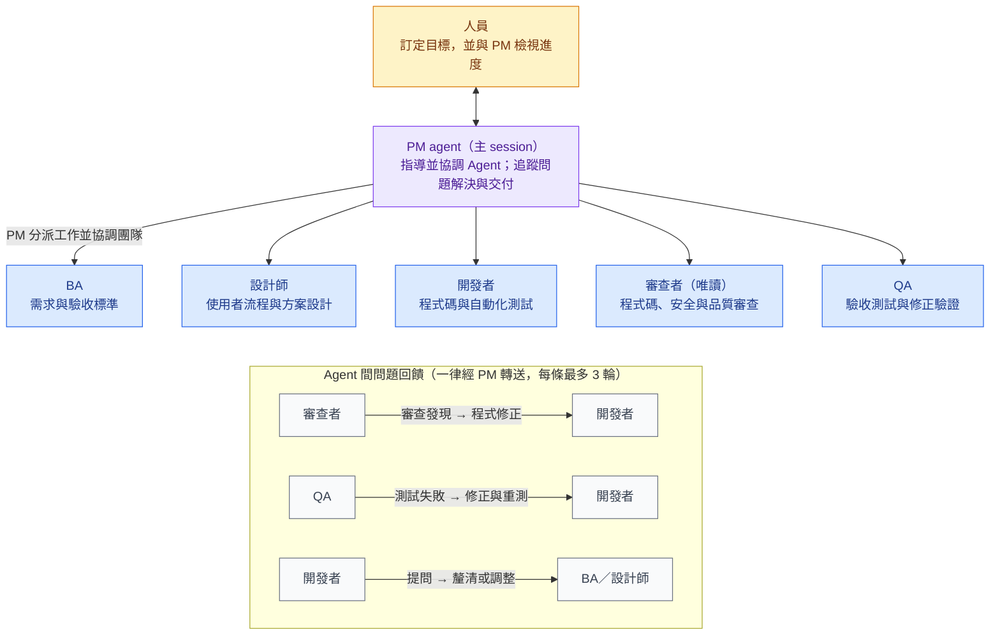
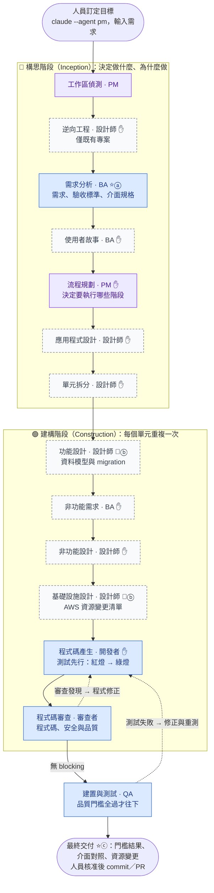
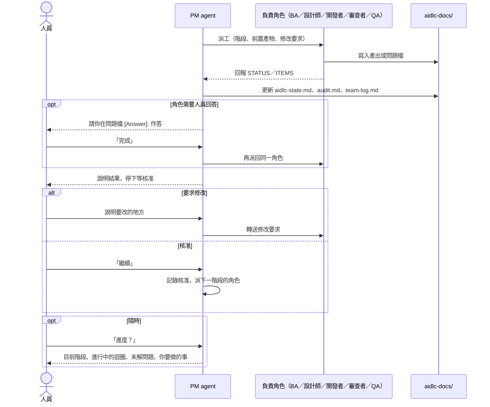
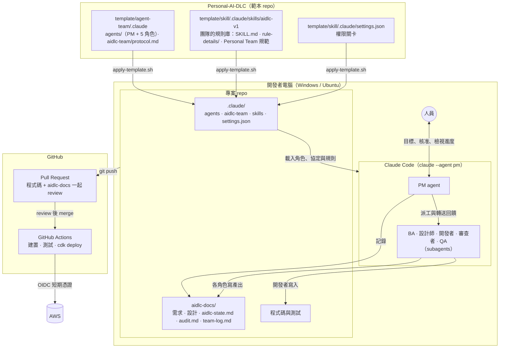

# Personal-AI-DLC

Personal Team 的 **AI-DLC（AI-Driven Development Lifecycle）協作交付團隊**：在 Claude Code 中以 **PM agent 統籌 BA／設計師／開發者／審查者／QA**，從需求到交付逐階段進行，每個階段由人員核准。

> **人員定方向、PM 統籌、Agent 協作。**

**要開始使用？看 [`INSTALL.md`](INSTALL.md)。**

## 團隊架構



| 角色 | 負責 | 實作 |
| --- | --- | --- |
| **人員** | 訂定目標，並與 PM 檢視進度；回答問題、核准每個階段 | 只和 PM 對話；問「進度」時 PM 回報目前階段、進行中的迴圈、未解問題與你下一步要做的事 |
| **PM agent** | 指導並協調 Agent；追蹤問題解決與交付 | 主 session（`claude --agent pm`）；一次派一個角色並等待回報；未解問題記在 `team-log.md`，交付前確認沒有未解的 blocking 問題 |
| **BA** | 需求與驗收標準 | 需求分析、使用者故事、非功能需求 |
| **設計師** | 使用者流程與方案設計 | 逆向工程、應用程式設計、單元拆分、功能／非功能／基礎設施設計；產出**介面規格**（路由、schema、錯誤碼）、**資料模型與 migration**、**AWS 資源變更清單** |
| **開發者** | 程式碼與自動化測試 | 程式碼產生（先核准計畫）、**測試先行**（紅燈 → 綠燈）、依回饋修正；完成時把變更存成 `changes.diff` 給審查者 |
| **審查者** | 程式碼、安全與品質審查 | **唯讀**（工具強制）；以這次的 diff 為範圍，檢查呼叫端與同類問題，依審查清單（信任邊界、並行、資料存取、資源與韌性、測試、Personal Team 規範）判定 |
| **QA** | 驗收測試與修正驗證 | 執行**品質門檻**（測試、介面契約、靜態分析、相依套件弱點、機密掃描、`cdk synth`／CDK 測試），逐條對照驗收標準；門檻全過才進入交付 |

**Agent 間問題回饋**：subagent 之間無法直接對話，三條回饋一律經 PM 轉送，每條最多 3 輪，超過由人員決定。

| 迴圈 | 觸發 | 處理 |
| --- | --- | --- |
| 審查者 → 開發者 | 審查發現 blocking 問題 | 開發者修正後再審查 |
| QA → 開發者 | 測試失敗 | 開發者修正後 QA 重測，並確認沒有回歸 |
| 開發者 → BA／設計師 | 需求或設計不清楚 | BA／設計師釐清或調整；改變已核准內容時先請人員核准 |

## 工作流程

PM 依 AI-DLC 的階段推進，把每個階段派給負責角色。實線框一定執行；虛線框由 PM 依需求複雜度決定。⭐ 是預設停點（ⓐ 規格與介面、ⓒ 最終交付）；🔶 是**高風險**（DB migration、IAM、有狀態資源等）時多停的設計確認（ⓑ）；✋ 是**嚴格**模式才停的其他階段。其餘階段給一行摘要就自動往下，**人力審查集中在前期的規格與設計，實作交給自動品質門檻**。



### 每個階段的互動方式



## 系統架構



- **團隊定義**：`template/agent-team/.claude/` 的 6 個 agent 與共用協定 `protocol.md`
- **規則庫**：各角色依 `template/skill/.claude/skills/aidlc-v1/` 的 AI-DLC 階段規則工作（上游 awslabs/aidlc-workflows v1.0.1 + Personal Team 本地規則）
- **交付**：程式碼與 `aidlc-docs/` 一起進 PR review；部署只由 GitHub Actions 透過 OIDC 執行，開發者電腦不放可部署的 AWS 憑證

## Personal Team 規則（所有角色適用）

| 規則 | 效果 |
| --- | --- |
| 繁體中文 | 對話與 `aidlc-docs/` 文件一律繁體中文；流程用的標記（`[Answer]:`、檔名、`aidlc-state.md` 欄位）維持原樣 |
| 核准模式（依風險） | PM 在流程規劃時判定風險：**低**（補測試、改訊息、不改介面的重構、加 alarm）→ **自動**，只在最終交付停；**中**（新 endpoint、無狀態資源）→ **標準**，停在規格與介面、最終交付；**高**（破壞性介面變更、DB migration、認證授權、IAM、有狀態資源、資源取代）→ **強化**，再多停資料模型與基礎設施設計，審查者逐行審查。可隨時說「用嚴格模式」「用自動模式」覆寫 |
| 擴充預設值 | **Security 預設啟用**；Resiliency、Property-Based Testing 預設停用；三者都不提問。要調整就對 PM 說「啟用 Resiliency」「關閉 Security」等；不適用的規則標示 N/A |
| Personal Team 規範（PTEAM-01～07） | 部署只走 CI + OIDC、AWS 資源用 CDK、IAM 最小權限、機密不進 repo、破壞性與成本變更標示（含 `cdk diff`）、自動化測試、EAC_Wiki 唯讀；違反即為 blocking，審查者逐條檢查 |
| 權限關卡 | `.claude/settings.json`：**高風險檔案**（`migrations/`、`*.sql`、`infra/`、`cdk/`、`*-stack.ts`、`.github/workflows/`、`auth/`、`.env*`）寫入前一定要你確認；**本機部署與強制推送直接禁止**（`cdk deploy`／`destroy`、`sam deploy`、`aws cloudformation deploy`／`delete-stack`、`git push --force`）；一般程式碼交給品質門檻，不再每檔詢問 |
| 品質門檻 | 依專案自動偵測、有設定才執行：測試（含 API 整合測試）、介面契約、lint／型別檢查、`npm audit`、機密掃描、`cdk synth`／CDK 測試／`cdk-nag`；**全部通過才送到你面前**，沒過自動退回開發者。`cdk diff` 需要 AWS 憑證，由 CI（OIDC 唯讀）在 PR 上執行 |
| 任務顆粒度 | 一個單元只做一件事（一個 endpoint、一個 migration 或一組相關資源，約 300 行內）；基礎設施與 migration 先、API 後 |
| 完成要有證據 | 每個角色回報附 EVIDENCE：開發者要有 TDD 紅燈與綠燈的指令與結果，QA 要有每條驗收標準的驗證結果；沒有實際執行結果，PM 視為未完成並派回 |
| 測試先行（TDD） | 開發者先寫測試並確認失敗（紅燈），再寫實作讓測試通過（綠燈）；修 bug 先寫能重現的失敗測試。沒有可測邏輯的變更可例外，或對 PM 說「這次不用 TDD」 |

### 選用：codebase-memory-mcp

專案有設定 [codebase-memory-mcp](https://github.com/DeusData/codebase-memory-mcp)（本機程式碼知識圖譜）時，設計師、開發者、審查者會改用圖查詢（`get_architecture`、`trace_path`、`detect_changes` 等）掌握結構與影響範圍，減少逐檔讀取的 token。沒有設定就照常讀檔，不影響使用。角色只用查詢類工具，不會自行重建索引。

## 安裝與啟動

**安裝、重新安裝、更新與使用方式見 [`INSTALL.md`](INSTALL.md)**（Windows／Ubuntu 分開說明）。

啟動（在專案目錄）：

```powershell
$env:CLAUDE_CODE_FORK_SUBAGENT = "0"; claude --agent pm
```

## 修改團隊（維護者）

```
開 branch → 修改 template/ → 實測 → 開 PR → review → merge 到 main → 通知各專案更新
```

1. 從最新的 `main` 開 branch：`git switch main && git pull && git switch -c feat/<描述>`
2. 修改：
   - 角色：`template/agent-team/.claude/agents/*.md`；共用規則：`template/agent-team/.claude/aidlc-team/protocol.md`
   - 規則庫：`template/skill/.claude/skills/aidlc-v1/`。`rule-details/` 上游檔案不改；客製寫在 `SKILL.md` 開頭或 `rule-details/extensions/personal-team/`，並記錄在 `UPSTREAM.md`
   - subagent 不會自動載入 `SKILL.md` 開頭的本地規則，改了本地規則時要同步更新 `protocol.md`
3. 在拋棄式目錄套用後用 `claude --agent pm` 跑一次小需求，確認派工順序、回饋迴圈與核准停點
4. 開 PR（標題與內文用繁體中文），merge 到 `main`
5. **PR merge 後，同一個 branch 再 push 的 commit 不會進 `main`**，要另開新的 PR

## 目前狀態

| 項目 | 狀態 |
| --- | --- |
| 協作交付團隊（PM + 5 角色） | ✅ 對齊架構圖；hello.js 端到端實測通過：PM → BA → PM → 開發者（計畫、核准後實作）→ 審查者 → QA，四個核准停點、`team-log.md` 與未解問題表皆正常 |
| 回饋迴圈（審查者／QA → 開發者、開發者 → BA／設計師） | ⏳ 實測時審查與測試一次通過，迴圈尚未實際觸發，待用較複雜的需求驗證 |
| 規則庫（v1.0.1 + Personal Team 本地規則） | ✅ 繁體中文、Personal Team 規範、權限關卡皆已實測 |
| 權限關卡（高風險路徑 ask、本機部署 deny） | ✅ 實測：`acceptEdits` 下 `src/app.js` 直接寫入；`infra/lib/api-stack.ts`、`db/migrations/001.sql` 被擋下要求確認；`cdk deploy --all` 被拒絕 |
| 完成證據、TDD、以 diff 為範圍的審查 | ✅ 實測（既有專案新增 `divide`、`add` 加型別檢查）：開發者兩輪 TDD 紅燈 → 綠燈（3／10 → 10／10、10／18 → 18／18）並附證據；產出 `changes.diff`，審查者以 diff 為範圍並查呼叫端；QA 驗證 AC-1～19，`npm test` 18 pass／0 fail |
| 依風險的核准模式 | ✅ 部分實測（Fastify 專案新增 `GET /items/:id`）：PM 判定**中風險** → 標準模式，停點記錄為 ⓐ 規格與介面、ⓒ 最終交付；ⓐ 只呈現介面表（200／400／404）、需求未寫明的假設、驗收標準與範圍外缺口，並自動略過不必要的逆向工程 |
| 品質門檻、高風險升級（migration 情境） | 🔄 已實作，待端到端實測 |
| 擴充預設值（Security 啟用；Resiliency、PBT 停用） | ✅ 實測：`aidlc-state.md` 記錄 Security 啟用、Resiliency／PBT 停用（來源「Personal Team 預設」），無問題檔，完成訊息附調整方式；不適用的 Security 規則標示 N/A |

## 限制

- 只有「審查者唯讀」與「PM 只能派這 5 個角色」由工具強制；其餘檔案所有權與核准 gate 靠 prompt 遵守，再以權限關卡補強程式碼寫入
- 權限關卡只涵蓋檔案編輯工具與列出的指令；`deny` 只比對指令文字，不是安全邊界（例如換個寫法就可能繞過），真正的防線是**本機不放可部署的 AWS 憑證**。`bypassPermissions` 模式下關卡無效，不要使用
- 高風險路徑是通用預設；專案的 migration 或 IaC 放在其他位置時，請在專案的 `.claude/settings.json` 補上對應路徑
- 每次交接都會重新讀取資料，token 用量高於單一 agent
- PM 沒有查詢時間的工具，`team-log.md` 的時間戳記為模型估計值，僅供排序參考

## 目錄結構

```
Personal-AI-DLC/
├── template/
│   ├── README.md                       範本說明
│   ├── agent-team/.claude/             協作交付團隊：agents/（PM + 5 角色）、aidlc-team/protocol.md
│   └── skill/.claude/                  規則庫：skills/aidlc-v1/（SKILL.md、rule-details/、UPSTREAM.md）、settings.json（權限關卡）
├── scripts/
│   └── apply-template.sh               把團隊套用到專案
├── INSTALL.md                          安裝、重新安裝與使用方式
└── AGENTS.md / CLAUDE.md               AI agent 在此 repo 的工作規則
```

## Branch 規則

- `main`：只放確定採用的內容
- `trial/*`：試用專用；試用產生的 `aidlc-docs/`、根目錄 `.claude/` **不 merge 進 `main`**，試用結束刪除 branch 即可

## 慣例

- 文件、commit message 描述、PR 標題與內文使用**繁體中文**；技術名詞與識別字維持原文
- `EAC_Wiki` 一律唯讀（詳見 [`AGENTS.md`](AGENTS.md)）
- 不在本機放可部署的 AWS 憑證；部署只走 CI + OIDC

## 維護者

- [josh-giant](https://github.com/josh-giant)

## 參考

- [awslabs/aidlc-workflows](https://github.com/awslabs/aidlc-workflows)：AI-DLC 官方實作（規則庫來源：v1.0.1）
- [AI-DLC Method Definition Paper](https://prod.d13rzhkk8cj2z0.amplifyapp.com/)：AI-DLC 方法論白皮書
- [`template/README.md`](template/README.md)：範本細節（角色工具、Personal Team 本地規則、權限關卡）
- [`UPSTREAM.md`](template/skill/.claude/skills/aidlc-v1/UPSTREAM.md)：規則庫的上游版本、授權與本地修改
